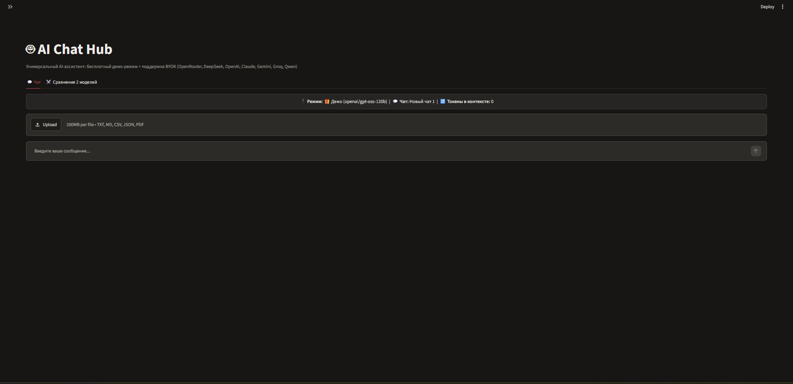
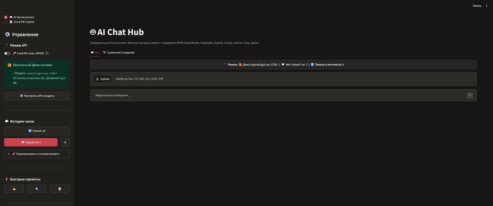
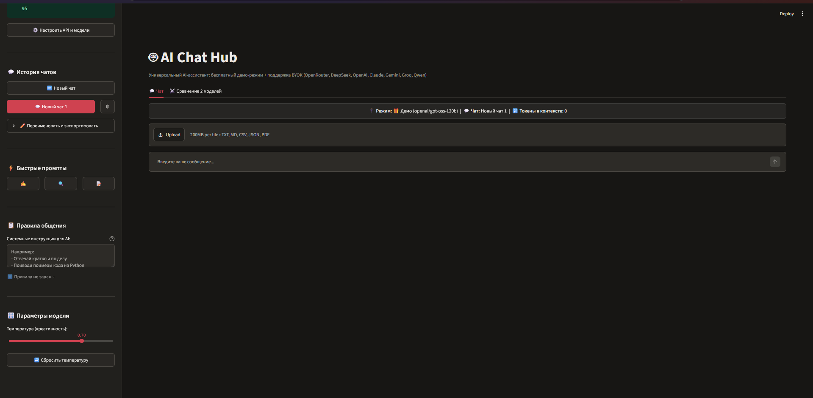
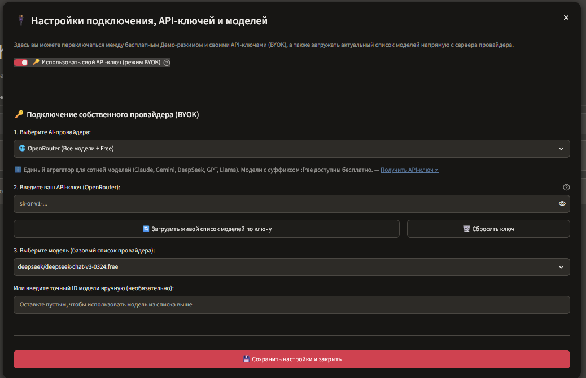

# AI Chat Hub

Мульти-провайдерный веб-чат на Streamlit с бесплатным демо-режимом и поддержкой собственных API-ключей (BYOK).

---

## Демо

Ссылка: https://johndmn-ai-chat-byok-app-tej9d6.streamlit.app/

Демо-режим работает на бесплатном ключе провайдера Groq. Лимиты: 15 запросов на одну сессию, 100 запросов в сутки на всех пользователей. При исчерпании лимита приложение предлагает перейти в режим BYOK.

---

## Скриншоты









---

## Возможности

- Чат с историей диалогов, переименованием чатов и экспортом в TXT.
- Два режима API:
  - бесплатный демо-режим (Groq, с лимитами);
  - режим BYOK со своим ключом.
- Поддержка провайдеров: OpenRouter, DeepSeek, OpenAI, Anthropic Claude, Google Gemini, Groq, Qwen.
- Динамическая загрузка списка доступных моделей через эндпоинт `/models` провайдера.
- Загрузка документов: PDF, TXT, MD, CSV, JSON.
- Сравнение ответов двух моделей по одному промпту.
- Быстрые промпты, системные инструкции и настройка температуры генерации.

---

## Статус проекта

Основной функционал чата протестирован и работает стабильно.

Режим «Jira & PM Copilot» находится в разработке и служит для проверки гипотез: реализованы декомпозиция требований, оценка методом PERT, аудит рисков, экспорт CSV/Markdown и базовый push в Jira, но не все сценарии проверены в реальных проектах.

---

## Ограничения и известные проблемы

- Демо-режим ограничен по количеству запросов; при превышении нужен собственный ключ.
- Работоспособность зависит от доступности внешних API выбранных провайдеров.
- Сравнение моделей возможно только в рамках одного провайдера/ключа.
- Загруженные документы обрезаются под размер контекста; сканы и изображения в PDF не распознаются.
- Push задач в Jira требует корректной настройки проекта и прав доступа.

---

## Как запустить локально

1. Клонировать репозиторий:
   ```bash
   git clone https://github.com/Johndmn/AI-Chat-BYOK.git
   cd AI-Chat-BYOK
   ```

2. Создать виртуальное окружение:
   ```bash
   python -m venv .venv
   ```
   Активировать:
   ```bash
   .venv\Scripts\activate.ps1       # Windows PowerShell
   # source .venv/bin/activate      # Linux / macOS
   ```

3. Установить зависимости:
   ```bash
   pip install -r requirements.txt
   ```

4. Настроить ключи:
   - Локально: скопировать `.env.example` в `.env` и заполнить `DEMO_API_KEY` или использовать режим BYOK.
   - Streamlit Cloud: добавить те же переменные в раздел Secrets.

5. Запустить приложение:
   ```bash
   streamlit run app.py
   ```

Приложение откроется по адресу `http://localhost:8501`.

---

## Как устроен проект

- `app.py` — точка входа и UI на Streamlit.
- `src/config.py` — реестр провайдеров и чтение настроек из переменных окружения.
- `src/llm_service.py` — работа с LLM, потоковая генерация, подсчет токенов, телеметрия.
- `src/rate_limiter.py` — потокобезопасный лимитер демо-запросов.
- `src/chat_state.py` — управление сессиями чатов в памяти пользователя.
- `src/document_parser.py` — чтение текстовых файлов и PDF.
- `src/jira_pm_service.py` — PM-инструменты: декомпозиция, оценка, риски, экспорт в Jira.

Вся бизнес-логика вынесена в `src/`, поэтому UI остается тонким слоем, а модули можно покрывать unit-тестами. Сессии пользователей изолированы через `st.session_state`; данные чатов и ключей не сохраняются на диск сервера.

---

## Технологии

- Python
- Streamlit
- OpenAI SDK
- tiktoken
- python-dotenv
- pypdf

Полный список зависимостей с зафиксированными версиями — в `requirements.txt`.

---

## Дальнейшие планы

- Доработать режим Jira & PM Copilot до стабильного состояния.
- Добавить OCR для сканов и изображений в PDF.
- Подготовить Docker-образ и CI/CD через GitHub Actions.

---

## Контакты

- Telegram: https://t.me/lonelyhunter18
- Email: javohirnodirov1718@gmail.com
